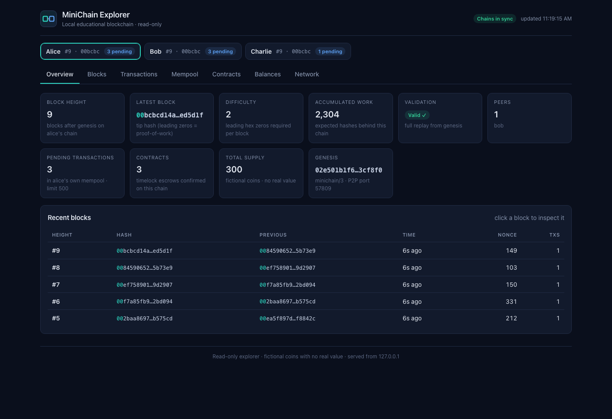
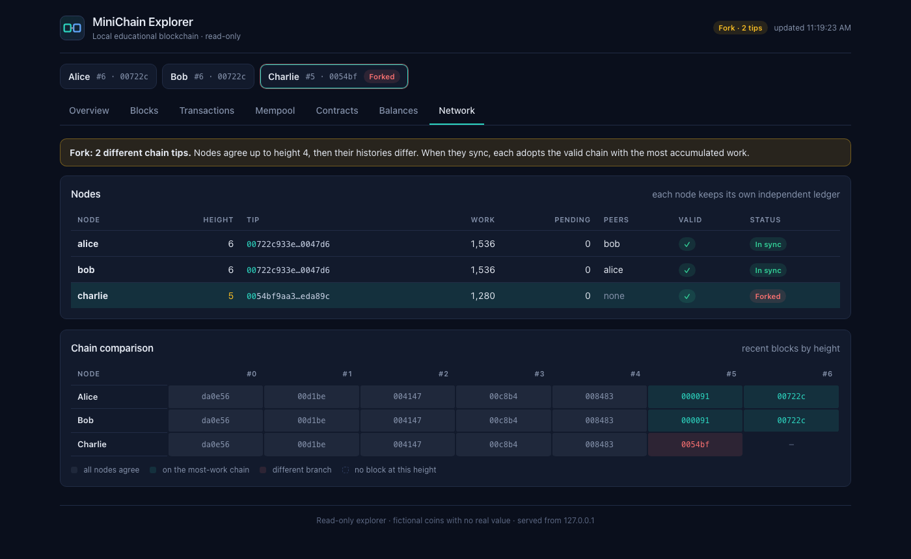
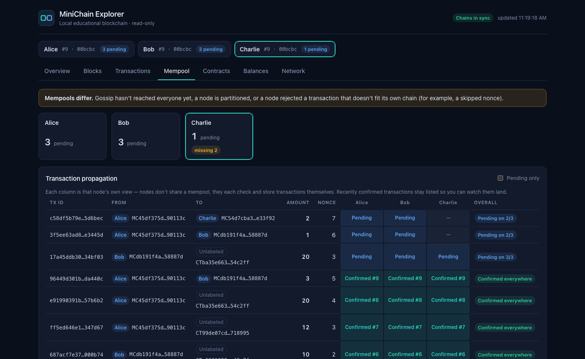
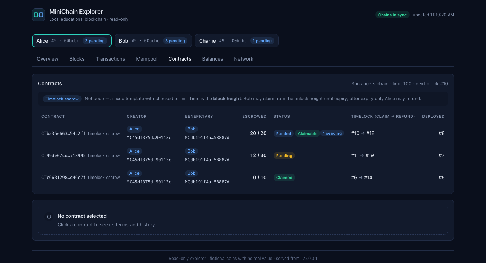
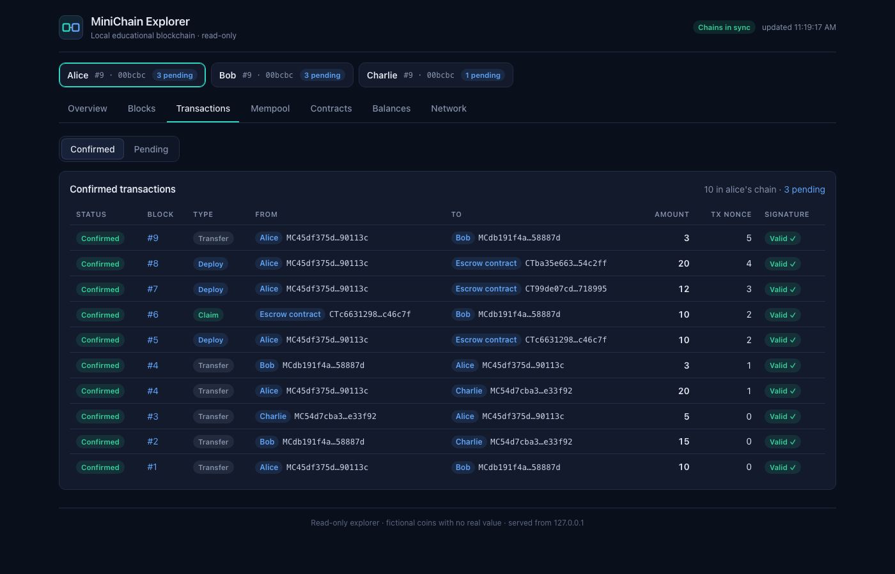
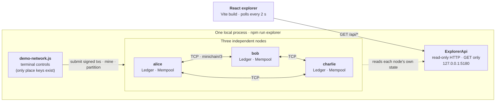
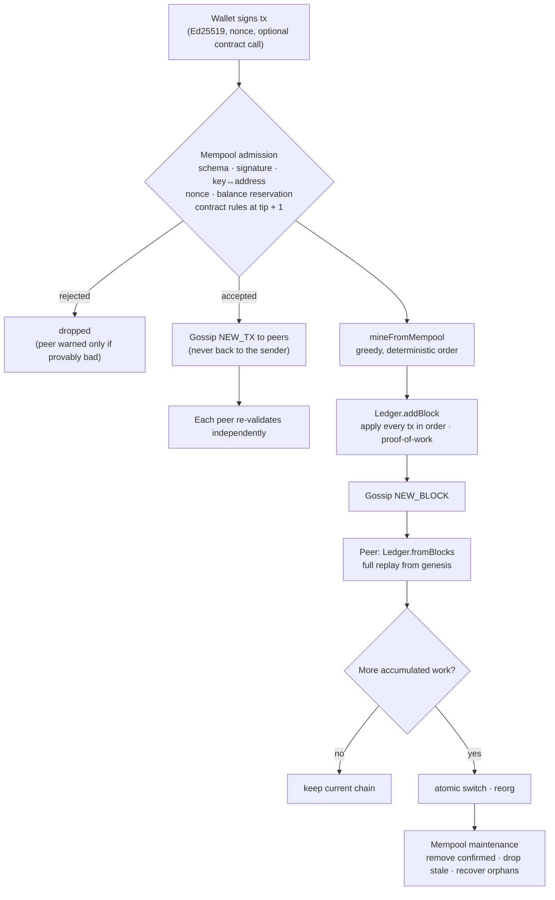

# MiniChain

**An educational blockchain built from scratch in Node.js** — proof-of-work, Ed25519-signed transactions, account balances, peer-to-peer gossip over TCP, a mempool, deterministic escrow smart contracts, and a React explorer that shows three independent nodes forking and reconverging in real time.

> ⚠️ **Educational project.** Coins are fictional and have no value. Everything runs on `127.0.0.1`. MiniChain has **no production security guarantees** — see [Security & limitations](#security--limitations).



- **No backend dependencies.** The blockchain uses only Node.js built-ins (`crypto`, `net`, `http`, `node:test`).
- **Built incrementally in nine milestones**, each with tests and a runnable demo.
- **362 backend tests + 57 frontend tests**, including real multi-node TCP tests, forks, reorganizations and malicious peers.

---

## Contents

- [Quick start](#quick-start)
- [What you'll see](#what-youll-see)
- [Architecture](#architecture)
- [Features](#features)
- [Milestones](#milestones)
- [Testing](#testing)
- [Project layout](#project-layout)
- [Security & limitations](#security--limitations)
- [Tech stack](#tech-stack)
- [License](#license)

---

## Quick start

**Requirements:** Node.js **20.19+** (or 22+) and npm. The backend has no dependencies; only the React explorer needs `npm` packages.

```bash
git clone https://github.com/sbaxend/minichain.git
cd minichain

npm run explorer:install   # installs the frontend's locked dependencies (npm ci)
npm run explorer           # builds the UI, starts 3 nodes + API + explorer
```

Open **http://127.0.0.1:5180**. The page refreshes every 2 seconds.

The browser is **read-only**. You drive the network from the terminal that runs the explorer:

| Key | Action |
|---|---|
| `t` | Create a signed Alice → Bob transfer and submit it to Alice's mempool (not mined) |
| `m` | Mine a block from the selected node's mempool (falls back to a demo transfer if it's empty) |
| `n` | Select the next node (alice → bob → charlie) |
| `f` | Fork: partition Charlie and let both sides mine competing blocks |
| `p` / `r` | Partition Charlie only / reconnect him **without** syncing chains (pending txs still exchange) |
| `s` | Sync / heal: Charlie adopts the chain with the most work (a reorganization) |
| `d` `a` `c` `e` | Escrow contract: **d**eploy, **a**dd funds, Bob **c**laims, Alice r**e**funds |
| `x` | Scripted contract reorg: a claim confirmed only on Charlie's branch is rolled back |
| `q` | Quit (closes every socket and server cleanly) |

Other entry points:

```bash
npm run demo:explorer -- --fork     # start already forked
npm run demo:explorer -- --check    # start, self-test over HTTP, exit (used in CI)
npm run demo:explorer -- --port 5181
npm run verify                      # all tests + production build + self-check
```

The earlier milestone demos print a narrated walkthrough in the terminal:

```bash
npm run demo:hash      # SHA-256 basics
npm run demo:chain     # linked blocks and tamper detection
npm run demo:mining    # proof-of-work and difficulty
npm run demo:wallets   # Ed25519 signatures and forgery attempts
npm run demo:balances  # balances, double-spend and replay protection
npm run demo:network   # 3 TCP nodes: fork, reorg, malicious peers
```

## What you'll see

| | |
|---|---|
|  **Network.** Charlie is partitioned on a shorter branch; the grid shows exactly where chains diverge. |  **Mempool.** Each node's own view of each transaction: unknown, pending, or confirmed. |
|  **Contracts.** Timelock escrows with parties, balance, status and the block-height windows. |  **Transactions.** Confirmed transfers and contract calls, with the real direction of coin flow. |

More: [balances](docs/screenshots/balances.png) · [recording guide](docs/demo-guide.md)

## Architecture



Each node owns its **own** ledger and mempool and trusts nothing it receives. This is how one transaction moves through the system:



**Key design decisions**

- **Validate everything, cache nothing.** Balances, nonces and contract state are re-derived by replaying the chain from genesis. A rejected candidate chain never touches the current ledger, and switching chains is a single assignment.
- **Fork choice is accumulated proof-of-work** (`blocks × 16^difficulty`), computed locally. A peer can't claim work, difficulty or validity: those fields don't exist in the protocol. Ties keep the first-seen chain.
- **Canonical serialization** (JSON with sorted keys, integers only) for every hash and signature, so all nodes agree byte for byte.
- **Contracts are data, not code.** One `timelock-escrow` template, four allow-listed operations, an explicit step meter, and **block height** as the only clock. There's no `eval`, no VM, no wall-clock time, no randomness and no floating point.
- **Strict, bounded protocols.** Newline-delimited JSON with exact field sets, 1 MB messages, a 500-transaction mempool, 25 pending transactions per sender, 2 KB per transaction, and strike-based disconnects.

## Features

**Core chain**
- SHA-256 block hashing with canonical serialization; linked blocks; tamper detection.
- Proof-of-work mining with a fixed, agreed difficulty; deterministic genesis.
- Ed25519 wallets (Node `crypto`); addresses derived from public keys; private keys kept in `#private` fields.
- An account-based ledger: initial allocation in genesis, sequential per-sender nonces, replay and double-spend protection, and coin conservation.

**Distributed system**
- Independent nodes over TCP on localhost: handshake checks the protocol version, genesis and difficulty; there's request/response with timeouts.
- Block and transaction gossip without loops; chain sync; reorganizations with orphan detection.
- A mempool with conservative admission (contiguous nonces, reserved pending spends), deterministic mining order, revalidation after every block or reorg, and bounded orphan recovery.
- Malicious-peer handling: forged signatures, overspending, missing proof-of-work, malformed or oversized messages.

**Smart contracts (timelock escrow)**
- `deploy` → `fund` → `claim` (beneficiary, within `[unlock, expiry)`) or `refund` (creator, from `expiry`).
- Deterministic contract IDs that commit to the creator, nonce and terms; strict schemas; atomic execution; limits on steps, storage, count and lock length.
- Full integration with block validation, the mempool, gossip and reorg rollback.

**Explorer**
- A read-only HTTP API (`GET` only, `127.0.0.1`, local `Host` check, size limits, no CORS, CSP on the built UI).
- A React dashboard with Overview, Blocks, Transactions (confirmed / pending), Mempool, Contracts, Balances and Network (fork) views; polling without overlapping requests; loading, empty, offline and error states; and bookmarkable URLs (`#contracts/charlie`).

## Milestones

| # | Milestone | What it added | Try it |
|---|---|---|---|
| 1 | SHA-256 hashing | `sha256()` on Node `crypto`; determinism and the avalanche effect | `npm run demo:hash` |
| 2 | Blocks & chain validation | Linked blocks, canonical serialization, tamper detection | `npm run demo:chain` |
| 3 | Proof-of-work | Mining nonce, difficulty, genesis exemption, cost of rewriting history | `npm run demo:mining` |
| 4 | Wallets & signatures | Ed25519 key pairs, addresses, signed transactions, forgery resistance | `npm run demo:wallets` |
| 5 | Balances & double-spending | Ledger replay, genesis allocation, per-sender nonces, replay protection | `npm run demo:balances` |
| 6 | P2P networking & consensus | TCP nodes, strict protocol, most-work fork choice, reorgs, malicious peers | `npm run demo:network` |
| 7 | React explorer | Read-only HTTP API + Vite/React dashboard over three live nodes | `npm run explorer` |
| 8 | Mempool & gossip | Pending pools, reservations, gossip, mempool sync, mining from the pool, orphan recovery | `t`, `m`, `p`, `r` |
| 9 | Deterministic smart contracts | Timelock escrow, block-height timelocks, contract API and view, reorg rollback | `d`, `a`, `c`, `e`, `x` |

Each milestone's details and design notes are in [docs/milestones.md](docs/milestones.md).

## Testing

```bash
npm test               # backend: node:test, 362 tests (incl. real localhost TCP)
npm run explorer:test  # frontend: Vitest + Testing Library, 57 tests
npm run explorer:build # production build
npm run verify         # all of the above + the explorer self-check
```

Network tests use random free ports on `127.0.0.1`, wait on **events** (never fixed sleeps) with timeouts, and stop every node afterwards. The suites were run repeatedly during development with no flaky failures. CI runs `verify` on Node 20.19 and 22 ([`.github/workflows/ci.yml`](.github/workflows/ci.yml)).

## Project layout

```
src/
  hash.js, serialize.js        SHA-256, canonical serialization
  block.js, blockchain.js      blocks, proof-of-work, structural validation
  wallet.js, address.js        Ed25519 keys, addresses, building transactions
  transaction.js               transfers + optional contract call, strict schema, signatures
  ledger.js                    balances, nonces, contract state; full replay validation
  contracts.js                 timelock-escrow template, executor, limits
  mempool.js                   pending pool, admission policy, rebuild after chain changes
  consensus.js                 accumulated work, fork choice, reorg description
  protocol.js, peer.js         wire format (NDJSON), framing, request/response, strikes
  node.js                      a P2P node: handshake, gossip, sync, mining
  api.js                       read-only explorer HTTP API (+ static UI)
  demo-network.js              three seeded nodes + scripted scenarios (holds demo keys)
examples/01–07                 runnable milestone demos (07 = explorer)
test/                          backend tests (node:test)
frontend/                      React + Vite explorer (components, hooks, tests)
docs/                          milestones, demo/recording guide, screenshots
```

## Security & limitations

MiniChain demonstrates the ideas, not a hardened system. By design it **does not** provide:

- Sybil resistance beyond proof-of-work, encryption or authentication between nodes, or rate limiting beyond strike counters.
- Peer discovery: nodes are connected manually by port.
- Persistence: wallets and chains live only in memory.
- Finality: any chain with more work can replace history, and at difficulty 2 a laptop can out-mine this network instantly.
- Fees, mining rewards, or economic incentives.
- Scalability: every check replays the chain, whole-chain sync is capped by the 1 MB message limit, and full transactions are gossiped rather than announced by ID.
- A general contract language: one escrow template only; claim or refund the whole balance; only the creator can fund.

Wallet keys exist only inside `demo-network.js` while the demo runs. The API never receives them, and the tests check that no private-key material appears in any API response. See [SECURITY.md](SECURITY.md).

## Tech stack

- **Backend:** Node.js 20.19+ (ES modules), using only built-in modules: `crypto` (SHA-256, Ed25519), `net` (P2P), `http` (API), `node:test`.
- **Frontend:** React 19, Vite 7, Vitest 4, Testing Library, jsdom. Plain CSS, with no UI framework.
- **Tooling:** GitHub Actions CI; exact dependency versions with a committed lockfile.

## License

[MIT](LICENSE). Educational use. Fictional coins only.
